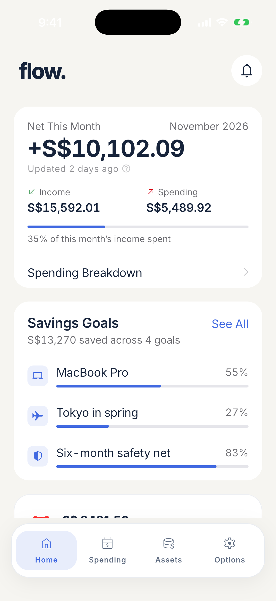
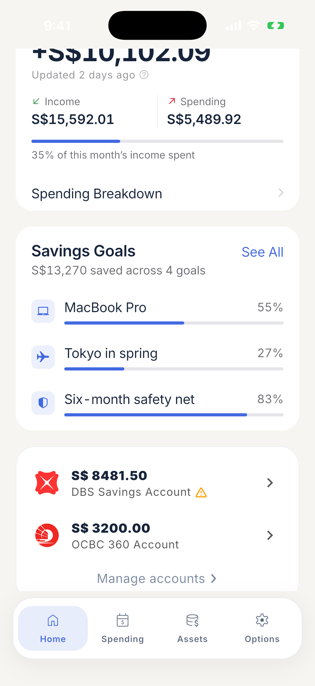
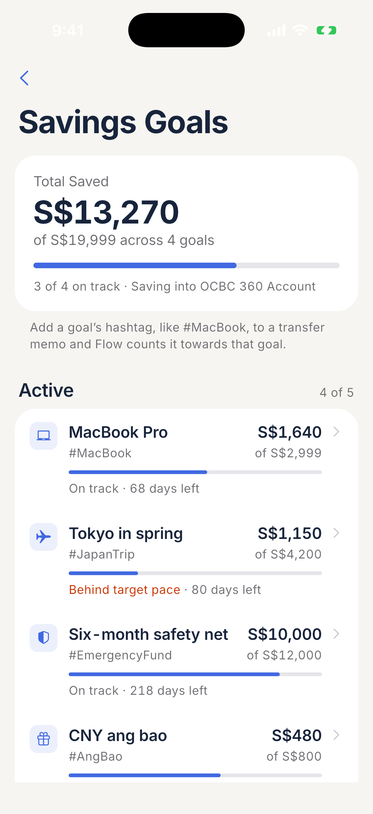
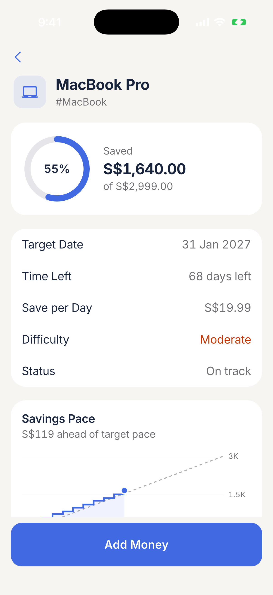
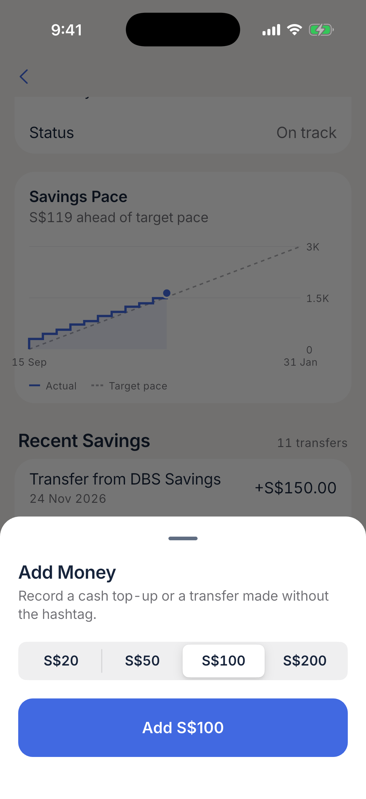
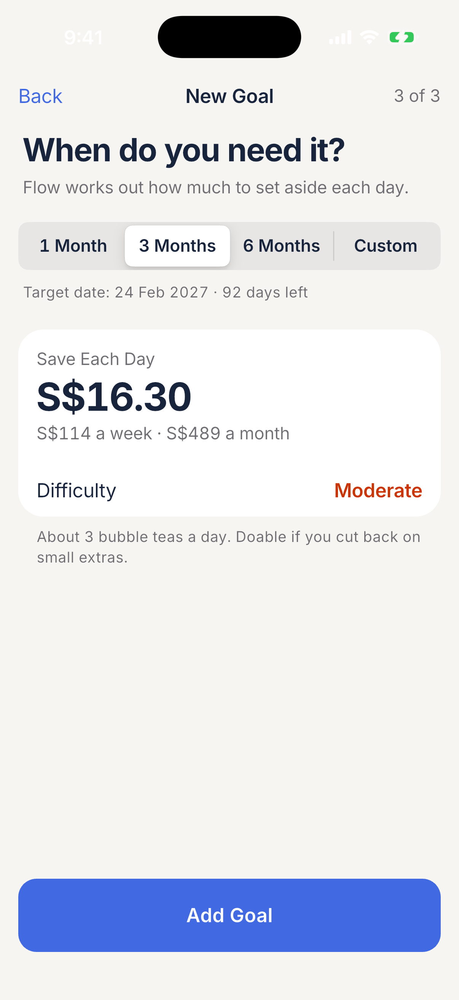
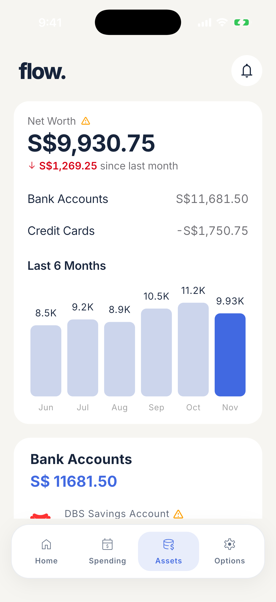
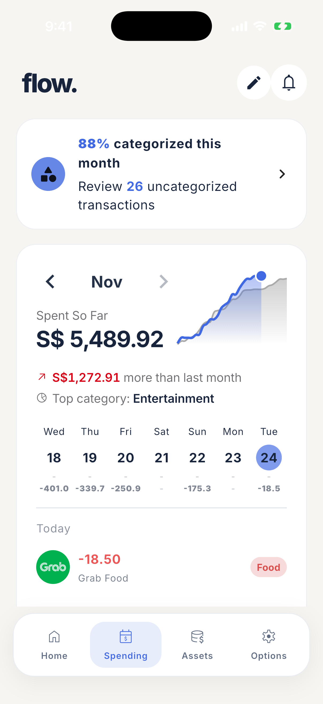

# Flow Financials | SEP Project and Progress Report

**Report date:** 24 November 2026 (first published 20 September 2026)  
**Project start:** August 2025  
**Team:** Flow Financials (Flow; listed as FlowOS in the iLab tracker)  
**Source code:** private repository (zzawook/flow). This public repository holds the SEP report and screenshots only, so reviewers can read it without repository access.

This document consolidates our project overview and progress reporting. The latest entry is the September-November 2026 update below. Earlier entries include a retrospective account of July-August and a supplement to our iLab filing of 16 September 2026. The retrospective entry is recorded now; it is not a backdated submission.

## Team

| Name | Role |
| --- | --- |
| Jae Hyeok Kim | Software Developer |
| Dobin Kim | Software Developer |

## Purpose and objectives

Flow is a personal finance management application for Singapore that helps users track, analyse and understand spending across multiple bank accounts.

Our objectives are to:
- Provide a clear, consistent mobile experience for viewing accounts, assets and spending.
- Support bank-connected financial tracking and transaction retrieval.
- Help users understand spending through AI-assisted transaction categorisation, recurring-spending detection and financial insights.
- Develop goal-based savings experiences.

These are project objectives, not a claim that every capability has been newly tested or completed in this reporting period. The repository README contains the technical architecture and component documentation.

## September-November 2026 progress update

**Reporting period:** 21 September-24 November 2026  
**Report date:** 24 November 2026  
**Names:** Jae Hyeok Kim and Dobin Kim  
**Team:** Flow Financials  
**Project start:** August 2025  
**Purpose:** A personal finance management app for Singapore that brings spending across multiple bank accounts into one place.  
**Objectives this period:** Start the goal-based savings objective with a Savings Goals interface, and make the main overview screens clearer and more consistent with iOS conventions.

### Work done

- **Savings Goals (UI prototype).** A Savings Goals card on Home, a goals list, and a goal detail screen with a progress ring, a savings-pace chart (actual against target pace) and an option to record money by hand. A three-step new-goal flow (goal type, name and amount, target date) previews the daily amount needed and how difficult the goal is relative to typical spending. Each goal has a hashtag that users would add to a transfer memo to count savings towards it.
- **Redesign of three overview screens** in an iOS-native style: the Home balance card, the Assets net worth card and the Spending overview. This also fixes insight text on the Spending overview that previously drew on top of itself.

**Implementation evidence:** branch sep/nov-2026-savings-goals, [commit 404fc962](https://github.com/zzawook/flow/commit/404fc96247845321a49f8ba49c8329398bab6a75) (private source repository) (Savings Goals and first redesign) and [commit 84e5bcda](https://github.com/zzawook/flow/commit/84e5bcdaf0c08743261e809f37b6edc0e0fbe12d) (private source repository) (iOS-style restyle).

### Screenshots (September-November 2026)

| Home balance | Savings Goals card | Goals list | Goal detail |
| --- | --- | --- | --- |
|  |  |  |  |

| Add money | New goal: date step | Assets net worth | Spending overview |
| --- | --- | --- | --- |
|  |  |  |  |

Screenshots use sample data.

### Validation and limitations

The app was built and run in an iPhone simulator. The full Flutter test suite was run on the branch: 8,096 tests pass and 2 fail; the same 2 tests also fail on the base branch (codex/ui-update), so they predate this work.

Savings Goals uses sample data and is not yet connected to live accounts. The demonstration also uses sample data rather than live bank logins. The work is on a branch and has not been merged or released.

### Video

[Narrated September-November walkthrough](https://youtube.com/shorts/4Q9iQZ0wlI4)

### Expenditure

Claim for subscriptions billed September-November 2026:

| Date | Item | Amount |
| --- | --- | ---: |
| 29 September 2026 | ChatGPT Pro subscription | S$138.00 |
| 29 October 2026 | ChatGPT Pro subscription | S$138.00 |
| 19 October 2026 | Claude Max subscription | S$149.99 |
| 19 November 2026 | Claude Max subscription | S$149.99 |
| **Total** | | **S$575.98** |

By charge date this is S$138.00 in September, S$287.99 in October and S$149.99 in November. The October and November charges are each within the approved S$300 per month for October-November. The 29 September charge pays for the 29 September-29 October billing period. These are claimed amounts, not confirmed reimbursements. The ChatGPT subscription has been cancelled and ends on 29 November 2026.

### Next steps (December 2026-January 2027)

1. Connect Savings Goals to live account data.
2. User-test the redesigned screens.
3. Planned expenditure: Claude Max at about S$150 per month (about S$300 in total), subject to prior approval.

## Status as of 20 September 2026

The latest documented development milestone is an overall visual UI/UX revamp. The implementation recorded on 16 September is on the separate codex/ui-update branch. This report does not claim that the UI branch has been merged or released. Publishing this document on main changes reporting documentation only.

### July-August 2026: retrospective progress

Work during this period focused on the overall visual UI/UX revamp. This retrospective description addresses the missing July reporting entry identified in the email correspondence. We are not attributing the September commit or its test results to an earlier date, and are not claiming a separate July submission was made.

### September 2026: documented UI milestone

The 16 September update covers:
- An ivory, navy and cobalt colour palette, with refreshed light and dark themes.
- A redesigned welcome screen and floating bottom navigation.
- Clearer dashboard hierarchy and asset layouts.
- Consistent cards, inputs, shared controls and settings presentation.
- Preservation of existing routes, callbacks and business logic.

**Implementation evidence:** [16 September UI refresh commit](https://github.com/zzawook/flow/commit/5ceb462f30154e97c265ba0f39dc35b222a28880) (private source repository), on codex/ui-update, covering 34 files with 482 additions and 276 deletions.

### Validation and limitations

Our 16 September iLab filing records 321 selected local tests passing and review of the main screens in an iPhone simulator. These are the results reported for that development milestone, not a new test run performed for this document.

The walkthrough uses sample data. Live login and bank connections have not been revalidated as part of this UI update. This milestone therefore does not establish end-to-end production readiness or new backend functionality.

## Video and demonstration

[September captioned UI/UX walkthrough](https://youtu.be/u8jfiVn5sZ8)

The existing video includes on-screen captions explaining the demonstrated changes. Whether those captions satisfy the requested explanatory format, or voice narration is additionally required, remains to be clarified with Prof Chng. This report does not claim that video-format compliance has been approved.

## Earlier reporting references

- **January 2026:** [Demo 1](https://youtu.be/54Fta0YFRtg) and [Demo 2](https://youtu.be/1xcWpcUH5mw), as listed in the email reporting history.
- **March-April 2026:** [Historical progress page](https://github.com/pimangnono/FLOW_progress_update/tree/main). Its beta testing, store approval and production-access entries are historical reports, not newly verified current store statuses. The current consolidated report is maintained here in zzawook/flow.
- **May 2026:** [Demo](https://www.youtube.com/shorts/csP1gopzk9E), acknowledged in the June email correspondence.
- **July 2026:** No submission was recorded in Teo's September summary; the retrospective explanation above addresses the reporting gap without backdating a filing.
- **September 2026:** Original iLab filing dated 16 September, supplemented by this consolidated report.
- **November 2026:** [Narrated walkthrough](https://youtube.com/shorts/4Q9iQZ0wlI4), with the September-November update above.

## Expenditure and funding status as of 20 September 2026

The September-November claim is in the update above.

The September email claim totals **S$391.90**:

| Item | Claimed amount |
| --- | ---: |
| Subscription, 29 July-29 August | S$139.27 |
| Subscription, 29 August-29 September | S$139.27 |
| OpenAI API credits, two charges of S$56.68 | S$113.36 |
| **Total** | **S$391.90** |

These are claimed amounts, not confirmed reimbursements. Explicit prior approval was not obtained for the API credits, and their reimbursement remains unresolved in the correspondence reviewed for this report. Supporting invoices and payment receipts were provided through the claims correspondence rather than reproduced here.

The future subscription request is for up to **S$300 per month for two months (October-November 2026)**, subscription only. Although an earlier email conveyed approval, Prof Chng's later reply requires the reporting updates to be reviewed before funding approval is discussed again, subject to the applicable SEP cap. We do not treat this as unconditional approval to incur expenditure. Future pay-as-you-go API usage requires explicit prior approval.

## Next steps as of 20 September 2026

The current next steps are in the September-November 2026 update above.

1. Review the refreshed interface and address remaining visual issues.
2. Revalidate live login and bank connections before release.
3. Clarify whether explanatory captions are sufficient or a narrated update is required; adjust the video if requested.
4. Maintain the consolidated GitHub report and submit updates through the iLab SEP Tracker at least every two months.
5. Obtain the required reporting review and funding confirmation before proceeding with the proposed subscription expenditure.

## Access and reporting notes

This public repository contains only the SEP report and screenshots. Flow's source code is kept in a private repository (zzawook/flow); commit links marked "private source repository" need access to that repository, and we can grant reviewers access on request. This report does not assert any new awards, investment, competitions or press coverage.
